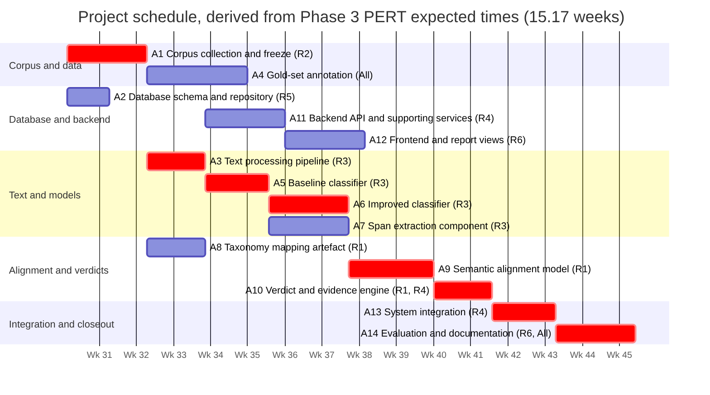

# Gantt chart

Supplementary to the approved Phase 3 System Design Document / SPMP, which
provides a **PERT chart and schedule analysis** (§15) but no Gantt chart.
**The approved report is not modified.**

Source: `gantt.svg`, `gantt.mmd` (Mermaid).

## Derivation — no duration was invented

Every bar length is the **expected time TE already published in Phase 3 §15.1**,
computed there as TE = (O + 4M + P) / 6. Start dates are the earliest starts
implied by the predecessor list in the same table:

&nbsp;&nbsp;ES(X) = max(EF of X's predecessors), EF(X) = ES(X) + TE(X)

| ID | Activity | Role | TE (wk) | Predecessors | ES | EF |
|---|---|---|---:|---|---:|---:|
| A1 | Corpus collection and freeze | R2 | 2.17 | — | 0.00 | 2.17 |
| A2 | Database schema and repository | R5 | 1.08 | — | 0.00 | 1.08 |
| A3 | Text processing pipeline | R3 | 1.58 | A1 | 2.17 | 3.75 |
| A4 | Gold-set annotation | All | 2.67 | A1 | 2.17 | 4.84 |
| A5 | Baseline classifier | R3 | 1.67 | A3 | 3.75 | 5.42 |
| A6 | Improved classifier | R3 | 2.17 | A5 | 5.42 | 7.59 |
| A7 | Span extraction component | R3 | 2.17 | A5 | 5.42 | 7.59 |
| A8 | Taxonomy mapping artefact | R1 | 1.58 | A1 | 2.17 | 3.75 |
| A9 | Semantic alignment model | R1 | 2.25 | A6, A7, A8 | 7.59 | 9.84 |
| A10 | Verdict and evidence engine | R1, R4 | 1.58 | A9 | 9.84 | 11.42 |
| A11 | Backend API and supporting services | R4 | 2.08 | A2, A3 | 3.75 | 5.83 |
| A12 | Frontend and report views | R6 | 2.17 | A11 | 5.83 | 8.00 |
| A13 | System integration | R4 | 1.67 | A10, A12 | 11.42 | 13.09 |
| A14 | Evaluation and documentation | R6, All | 2.08 | A4, A13 | 13.09 | **15.17** |

**The computed finish is 15.17 weeks, which is exactly the figure Phase 3
§15 states.** That agreement is the check that this chart is a faithful
rendering of the approved plan rather than a new one.

## Critical path

**A1 → A3 → A5 → A6 → A9 → A10 → A13 → A14**, shown in red. The durations sum
to 15.17 weeks, so every activity on it has zero float.

A7 (span extraction) runs in parallel with A6 and has the same expected time,
so it is jointly critical: either can delay A9. Phase 3 §15 draws the
consequence — the schedule is governed by the model chain, and because A6 and
A7 both belong to role R3, that role is the bottleneck and the two cannot be
compressed by reassigning work within it.

Activities with float: A2 (6.09 weeks), A4 (8.25), A8, A11, A12.

## Honest note on A4 and A14

A4, gold-set annotation, has the largest float in the plan and was **not
completed**: the approximately 100-application gold set does not exist, which
is why FR-27 is not implemented. The chart shows the activity as planned, not
as delivered. This document renders the approved schedule; what was actually
delivered against it is in `FINAL_SUBMISSION_AUDIT.md`.

## Calendar

Week numbers on the axis are relative to an assumed project start. Phase 3
fixes durations and dependencies but not a start date, so **[assumed]** a
start at the beginning of week 31 for rendering purposes only. No historical
date is claimed.
