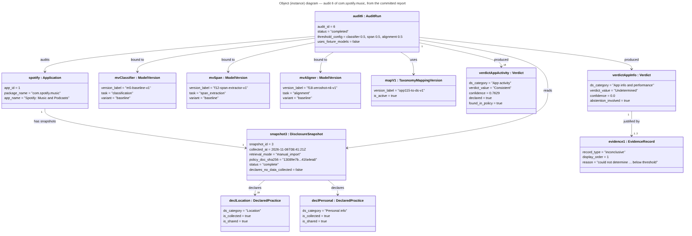

# UML object (instance) diagram

Supplementary to the approved Phase 3 System Design Document, which provides
four **class** diagrams (domain, analysis A and B, orchestration) but no
**object** diagram. **The approved report is not modified.**

An object diagram is a snapshot: it shows particular instances with their
actual attribute values at one moment, rather than the types. Every value
below is read from committed project evidence, not invented.

Source: `object_diagram.svg`, `object.mmd` (Mermaid).

## What this snapshot shows

The state of the database immediately after **audit 6** of
`com.spotify.music` completed. Audit 6 was chosen because its full report is
committed as `spotify_audit_6_report.json` and every value here can be checked
against it. Audit 13 has the same object structure with
`mvClassifier.version_label = "f11-improved-v1"` and
`mvClassifier.variant = "improved"`.

| Object | Class | Where the values come from |
|---|---|---|
| `spotify` | `Application` | `data/corpus/apps/com.spotify.music/record.json` |
| `snapshot3` | `DisclosureSnapshot` | the same record; policy SHA-256 `13089e7b…4ea8` |
| `declLocation`, `declPersonal` | `DeclaredPractice` | 2 of the 19 real Data Safety entries |
| `audit6` | `AuditRun` | `spotify_audit_6_report.json` |
| `mvClassifier`, `mvSpan`, `mvAligner` | `ModelVersion` | the `models` block of that report |
| `mapV1` | `TaxonomyMappingVersion` | `opp115-to-ds-v1`, the active mapping |
| `verdictAppActivity` | `Verdict` | App activity, Consistent, confidence 0.7629 |
| `verdictAppInfo` | `Verdict` | App info and performance, Undetermined, confidence 0.0 |
| `evidence1` | `EvidenceRecord` | the inconclusive record justifying that abstention |

## Three things the snapshot makes visible

**An audit points at model versions, not at models.** `audit6` holds three
`ModelVersion` references. That is what makes a report reproducible and is why
a report can never name a model that did not run (F-13, F-34).

**A Consistent verdict carries no evidence record.** `verdictAppActivity` has
no `EvidenceRecord` attached, by design under F-23: agreement between the two
sources is not quoted. Only `verdictAppInfo`, an abstention, carries one.

**The abstention records why.** `evidence1` has `record_type = "inconclusive"`
and a reason in prose. Its `quoted_text` is null in audit 6 — that was defect
C-91, where persistence dropped the candidate passage. Audits run after the
fix carry the passage the system abstained on.

## Multiplicities in this instance

* 1 application → 3 snapshots (collection events), of which `snapshot3` is the
  one audit 6 read
* 1 snapshot → 19 declared practices
* 1 audit → 14 verdicts, one per Data Safety category
* 1 Undetermined verdict → 1 to 3 inconclusive records (F-22 caps at 3)
